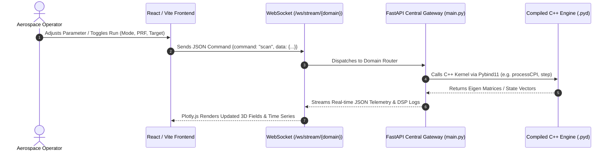

# Advanced Project Design: System Architecture

## Overview
This workspace is designed using a **System of Systems** architecture. It integrates multiple complex aerospace and defense engineering disciplines (Aerodynamics CFD, Chemical Rocket Propulsion, Phased Array Radar & Pointer Dynamics, and Spacecraft Attitude & Orbit Dynamics) into a unified, high-performance distributed ecosystem.

The core architectural paradigm is **Centralized Gateway, Decentralized Mathematics**:
- **C++ Physics Engines (Eigen3 + Pybind11):** Heavy linear algebra and numerical physics run at native machine speed with zero overhead.
- **FastAPI Monolithic Gateway (`Central_API_Server/main.py`):** Unified asynchronous routing, state caching, and high-frequency bi-directional WebSocket streaming (`/ws/stream/{domain}`).
- **React/Vite Industrial SPA (`Central_API_Server/frontend/`):** Dynamic single-page application rendering tactical dashboards with 60 FPS Plotly.js charts, interactive controls, and terminal logging.

---

## 1. Directory & Repository Structure

The workspace is organized into independent Git repositories representing distinct domains:

- **`Radar_Systems/`**: High-fidelity phased array beamforming, pulsed Doppler DSP, CA-CFAR detection, 7-state IMM-EKF kinematic tracking, true STAP clutter cancellation, and Newton-Euler Hexapod / Euler-Lagrange Az/El Pointer Dynamics (`radar_core`).
- **`Aerodynamics_CFD/`**: 3D finite volume compressible Navier-Stokes and Euler solvers with AUSM+ flux splitting, LSQ gradient reconstruction with limiters, DDES turbulence modeling, and Gmsh unstructured meshing (`aero_core`).
- **`Propulsion/`**: Rocket nozzle optimization via Method of Characteristics (MoC) Rao bell contouring, coupled with Bartz convective heat transfer, Fourier conduction, and Lamé thick-wall stress margins (`prop_core`).
- **`Spacecraft_SADC/`**: Two-body continuous orbital propagation, Earth sidereal rotation, 6-DOF quaternion kinematics, Euler's rotational equations with inertia cross-coupling, gravity gradient disturbance, and LQR line-of-sight tracking for ground stations (`sadc_core`).
- **`Tracker/`**: Control system laws and SolidWorks mechanical CAD assemblies for tracking hardware (slip rings, 1:4 spiral bevel gears, rotors).
- **`Central_API_Server/`**: High-throughput FastAPI gateway, asynchronous WebSocket streaming (`/ws/stream/{domain}`), and commercial-grade React/Vite/Plotly single-page application.
- **`System_Shared_Libraries/`**: Common vendor libraries (Eigen 3.4.0) and MEX wrappers for legacy research compatibility.

---

## 2. Core Architectural Principles

### A. The "C++ as the Source of Truth" Rule
To achieve real-time simulation performance, mathematical kernels run natively in C++ using `Eigen` for linear algebra. C++ source code is the single ground truth for the mathematical and physical behavior of each system.

### B. Python API Bindings (Pybind11)
C++ core engines are compiled into native Python extension modules (`.pyd` on Windows, `.so` on Linux) using `pybind11` and CMake/Ninja. This enables the Central API Server to execute compiled C++ physics routines in-memory without inter-process communication serialization penalties.

### C. Rigorous Mathematical Documentation
All code strictly adheres to Professional Engineering standards:
- Explicit derivations and governing equations are documented in header and source docstrings.
- Mathematical approximations (e.g., small-angle assumptions, constant-gamma expansions, two-body spherical Earth) must be explicitly stated.
- Published literature references (e.g., *Bartz 1957*, *Wertz 2011*, *Schaub & Junkins*, *Bader 2004*) are mandated for empirical formulas.

---

## 3. Data Flow & Streaming Architecture

1. **Frontend Interaction:** User modifies parameters in glassmorphic sidebars and initiates real-time streaming or batch solve.
2. **WebSocket Message:** Client sends JSON command payload across persistent WebSocket connection (`/ws/stream/radar`, `/ws/stream/aero`, `/ws/stream/prop`, `/ws/stream/sadc`).
3. **Gateway Dispatch:** FastAPI router parses parameters, updates session state, and invokes C++ core functions in thread/process pools.
4. **C++ Execution:** High-throughput math executes natively on CPU using SIMD-accelerated Eigen routines.
5. **Real-Time Streaming:** Gateway serializes arrays and sends results + developer log telemetry back to the UI in sub-millisecond intervals.
6. **Dynamic Rendering:** UI plots live 3D surface meshes, Doppler heatmaps, polar PPI blips, and flight traces smoothly.

---

## 4. Verification & Testing

Every domain is validated using strict Test-Driven Development (TDD):
- **Unit Tests:** Located in each domain's `tests/` directory (e.g., `Spacecraft_SADC/tests/test_sadc_math.py`).
- **System Parity Tests:** Located in root `tests/test_parity.py`, asserting numerical parity between legacy MATLAB baselines and modernized C++ engines with strict tolerances (`rtol=1e-5`).
